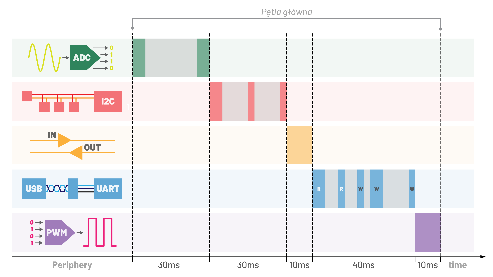
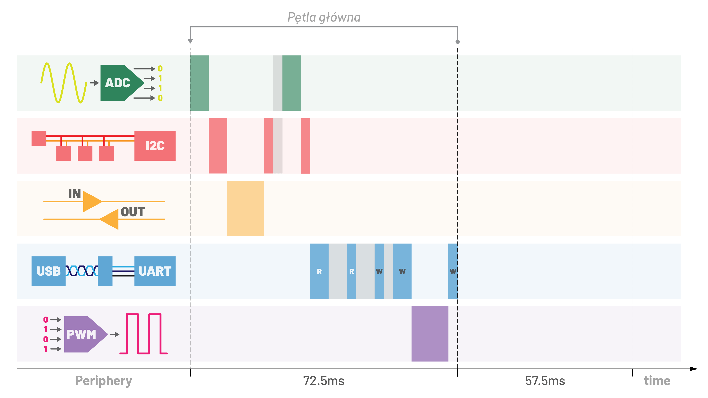
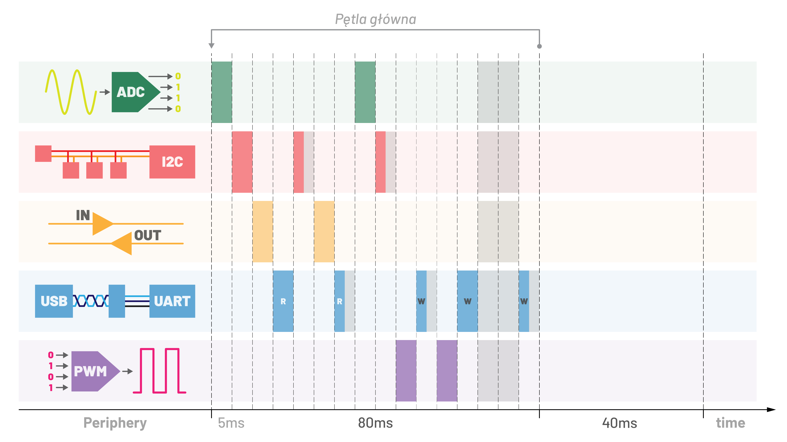
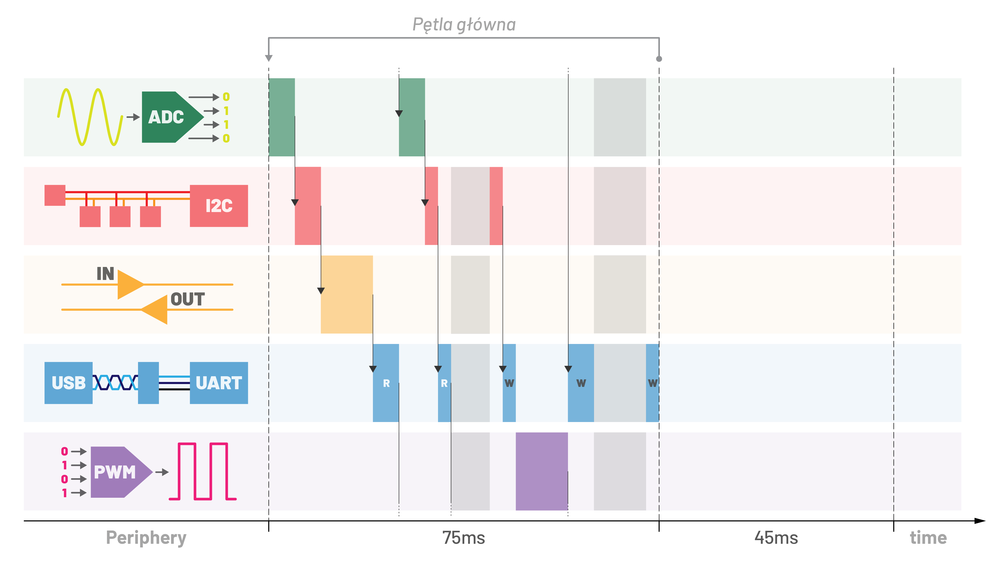
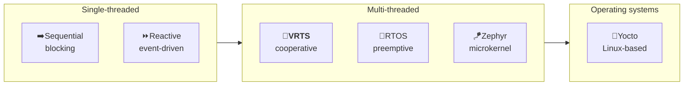

# 

**VRTS** _(Voluntary Release Threads System)_ is a lightweight cooperative multitasking library for STM32 _(CM0+, CM4F)_ and desktop simulation _(Linux, Windows)_.
Unlike RTOS, threads are never preempted: each one decides when to hand off the CPU.
This makes code easier to reason about, and lets you develop and test in a single thread, then drop into multi-threaded execution with minimal changes.

## 💡 Concepts

Embedded applications need to handle multiple tasks at once: reading sensors, communicating, controlling outputs.
How you structure that has a big impact on complexity and resource use.

**Single-threaded**

- ➡️**Sequential**: blocks on every operation. Simple, but the CPU sits idle while waiting for ADC, UART, timers.
- ⏩**Reactive** _(event-driven)_: interrupts and callbacks keep the CPU busy, but logic fragments across handlers. Libraries become tightly coupled to the application.

**Multi-threaded**

- 🔀**VRTS**: threads yield the CPU voluntarily. No preemption, predictable execution, minimal overhead. Develop and test each thread in isolation, then register them.
- 🔁**RTOS** _(FreeRTOS)_: preemptive, fixed time slices. Powerful but adds overhead, requires mutexes and careful handling of shared memory.
- 🪁**Zephyr**: full microkernel RTOS with hardware abstraction layer. Scales to complex systems, significantly larger footprint.

**Operating systems**

- 🐧**Yocto**: Linux-based, full OS stack. Requires MMU, orders of magnitude more resources. For application processors, not microcontrollers.

Pictures below show the same set of tasks run four ways.

<table>
  <tr>
    <td width="50%"></td>
    <td width="50%"></td>
  </tr>
  <tr>
    <td width="50%" align="center">Sequential</td>
    <td width="50%" align="center">Reactive</td>
  </tr>
  <tr>
    <td width="50%"></td>
    <td width="50%"></td>
  </tr>
  <tr>
    <td width="50%" align="center">RTOS</td>
    <td width="50%" align="center"><b>VRTS</b></td>
  </tr>
</table>



## 🆚 Comparison

Subjective comparison of embedded programming approaches.
Circles rank approaches in each feature, from red, least favorable, through yellow to green, and blue marks an order-of-magnitude lead.

| Feature | Sequential | Reactive | VRTS | FreeRTOS | 🪁 Zephyr | 🐧 Linux (Yocto) |
| :----- | :---: | :---: | :---: | :---: | :---: | :---: |
| RAM & Flash footprint | 🟢🟢🟢 | 🟢🟢🟢 | 🟢🟢 | 🟡🟡 | 🟡 | 🔴 |
| Energy efficiency | 🟡 | 🟢🟢🟢 | 🟢🟢 | 🟢🟢 | 🟢🟢 | 🔴 |
| Jitter | 🔴 | 🟡🟡 | 🟢🟢 | 🟢🟢🟢 | 🟢🟢🟢 | 🟡 |
| Throughput | 🟢🟢🟢 | 🟢🟢🟢 | 🟢🟢🟢 | 🟢🟢 | 🟡🟡 | 🟡 |
| Scalability | 🔴 | 🟡 | 🟡🟡 | 🟢🟢 | 🟢🟢🟢 | 🔵🔵🔵 |
| Ease of use | 🟢🟢🟢 | 🟡🟡 | 🟢🟢 | 🟡🟡 | 🟡 | 🔴 |
| Code readability | 🟢🟢🟢 | 🟡 | 🟢🟢🟢 | 🟡🟡 | 🟢🟢 | 🟡🟡 |
| No synchronization needed | 🟢🟢🟢 | 🟢🟢🟢 | 🟢🟢 | 🟡 | 🟡 | 🟡🟡 |
| Ecosystem & community | 🟢🟢 | 🟡🟡 | 🟡 | 🟢🟢🟢 | 🟢🟢 | 🟢🟢🟢 |

VRTS falls behind RTOS in three features.
Without priorities jitter grows, so urgent work belongs to interrupts and hardware.
The same lack of preemption favors throughput: under a burst of tasks, less time goes to context switches and synchronization.
Scalability matters less in controllers and IoT devices than in general-purpose systems.
Ecosystem is weaker, since cooperative multitasking in C comes today mostly as RTOS modes, with full kernel overhead, or as stackless libraries such as protothreads.
VRTS fills that gap: full thread stacks without a whole RTOS.

## 🚀 Getting Started

All timing functions are based on the `systick_init` base tick.
Thread switching and time tracking are tightly integrated: `delay`, `timeout` and `tick_*` all cooperate with `let` under the hood.
Threads waiting in `delay`, `delay_until` or `timeout` are skipped: `let` of other threads checks their tick or condition without switching to them.
When all threads wait, the core sleeps in `WFI` until any interrupt, system tick included.

### Setup

Cortex-M0+ and Cortex-M4F builds take `src/vrts.c` and `src/vrts_pendsv.s`, whose context switch picks its variant by core.
`vrts.h` picks the device header by `STM32G0`, `STM32G4` or `STM32WB`, and `main.h`, included after it, may bring another one.
Linux and Windows builds take `src/host/vrts.c` instead, with `src/host` ahead of `src` on the include path.
Project `main.h` overrides defaults:

```c
#define VRTS_THREAD_LIMIT 5
#define VRTS_SWITCHING 1
#define VRTS_THREAD_TIMEOUT_MS 2000 // longest hold of the core, `0` = off
```

```c
#include "vrts.h"

stack(main_stack, 256); // size in words: 1KB
stack(temp_stack, 128);
stack(adc_stack, 128);

int main(void)
{
  systick_init(10); // 10ms base tick
  thread(Main_Thread, main_stack);
  thread(Temp_Thread, temp_stack);
  thread(Adc_Thread, adc_stack);
  vrts_init(); // does not return
}
```

### `let`

Yields the CPU to the next thread.
Call it whenever your thread has nothing urgent to do.

```c
void UART_Thread(void)
{
  while(1) {
    size_t len = UART_Read(&msg);
    if(len) {
      // Handle message
    }
    let(); // hand off to next thread
  }
}
```

### `delay` / `sleep`

Both wait for the specified time.
`delay` yields to other threads while waiting.
`sleep` blocks: no switching occurs.

```c
GPIO_Set(&gpio);
delay(1000); // 1s: other threads run
GPIO_Rst(&gpio);
```

```c
GPIO_Set(&gpio);
sleep(200); // 200ms: core is locked to this thread
GPIO_Rst(&gpio);
```

### `timeout`

Waits for a condition with a deadline.
Requires a callback returning `true` when the condition is met.
Returns `true` if timed out.
`let` of other threads checks the condition too, and its first `true` ends the wait, so conditions cleared on read are safe.
When all threads wait, conditions no interrupt sets, such as pin state, are seen at the next tick.

```c
ADC_Start(&adc);
if(timeout(50, WAIT_&ADC_IsFree, &adc)) {
  // Error: measurement took too long
}
else {
  uint16_t value = ADC_Get(&adc, 3); // channel 3
}
```

### `tick_keep` + `tick_over`

Schedule a one-shot task across threads.
`tick_keep` sets a deadline, `tick_over` fires once when it expires and resets.

```c
uint64_t deadline;

void Thread_1(void)
{
  if(!deadline) deadline = tick_keep(500); // arm: 500ms from now
  let();
}

void Thread_2(void)
{
  if(tick_over(&deadline)) {
    // Runs once, 500ms after Thread_1 armed it
  }
  let();
}
```

### `tick_keep` + `tick_away`

Poll a deadline continuously.
`tick_away` returns `true` while waiting, then resets it and returns `false` once expired.

```c
uint64_t deadline = tick_keep(1000);

while(tick_away(&deadline)) {
  // Do work while time remains
  let();
}
// Time's up
```

### `tick_diff`

Measure elapsed time since a reference tick.

```c
void Thread(void)
{
  uint64_t ref = tick_keep(0); // capture now
  // ... some calculations ...
  int32_t elapsed_ms = tick_diff(ref);
}
```

### Faults

`let` checks canary word at the bottom of each thread stack, and stack overrun ends in `vrts_panic`.
Threads holding the core past `VRTS_THREAD_TIMEOUT_MS` end there too.
`vrts_panic` is weak: by default it masks interrupts and halts, and applications may provide their own.

### Tickless idle

With `VRTS_TICKLESS 1`, idle core stops system tick and sleeps up to the nearest deadline.
Sleep comes from `pwr.h` of the platform: `uint32_t PWR_Idle(uint32_t ms, bool stop)`, called with interrupts masked, sleeps up to `ms` and returns time asleep in µs, `0` for a sleep it could not time.
OpenCPLC provides it on STM32G0.
Weak `vrts_idle_stop()` picks Stop 1 over Sleep, `false` by default: Stop halts the clock, and with it timers, DMA and ADC.
Conditions no interrupt sets are then seen only at their deadline.

### Example

Three [**LEDs blink**](example.c) independently, each in its own thread.

## 📚 Heap

VRTS includes a deterministic heap allocator and a per-thread garbage collector: a drop-in replacement for `malloc`/`free` without the stdlib overhead.
Because VRTS is cooperative, a single shared heap is safe: no thread can interrupt another mid-allocation, so no locking is needed.
With RTOS this is a real problem: preemption requires either per-thread heaps _(memory overhead)_ or mutexes around every allocation _(complexity and latency)_.

Call `heap_init()` once before use:

```c
heap_init();
```

### Allocator

Standard alloc/free/realloc with block splitting and coalescing.

```c
uint8_t *buf = heap_alloc(64);
// Use buf...
heap_free(buf);
```

```c
buf = heap_reloc(buf, 128); // resize: copies data if needed
```

Configure in `main.h`:

```c
#define HEAP_SIZE 8192  // total heap in bytes
#define HEAP_ALIGN 8    // allocation alignment
```

### Garbage collector

`heap_new` allocates memory tracked per-thread.
`heap_clear` frees everything allocated by the current thread in one call: no manual tracking needed.

```c
void Uart_Thread(void)
{
  while(1) {
    char *line = heap_new(64);
    char *resp = heap_new(128);
    // Use line, resp...
    heap_clear(); // free all at once
    let();
  }
}
```

Each thread has its own GC stack: `heap_clear` in one thread does not affect allocations made in another.
The stack grows automatically in `HEAP_NEW_BLOCK`-sized steps.

```c
#define HEAP_NEW_BLOCK 16 // growth step (number of tracked pointers)
```