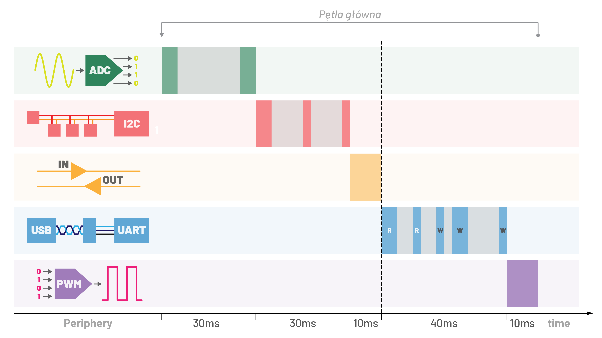
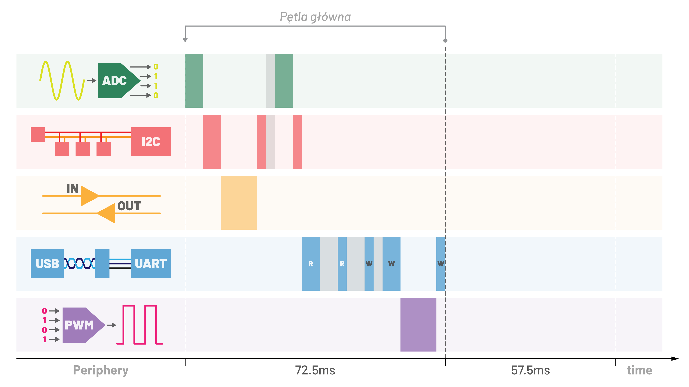
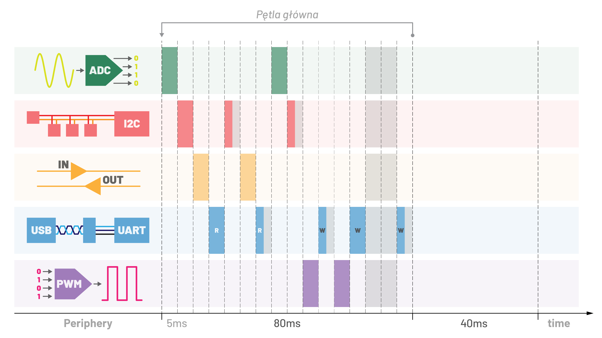
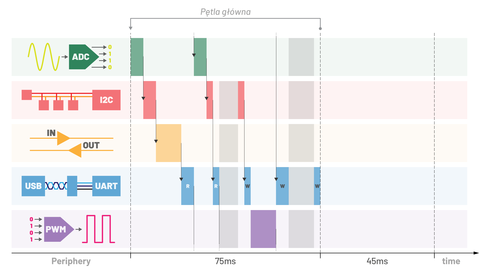
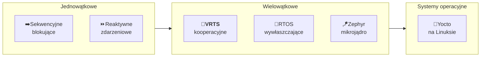

# 

**VRTS** _(Voluntary Release Threads System)_ to lekka biblioteka kooperacyjnej wielowątkowości dla STM32 _(CM0+, CM4F)_, która do symulacji działa też na komputerze _(Linux, Windows)_.
W przeciwieństwie do RTOS-a wątek nigdy nie jest wywłaszczany i sam decyduje, kiedy oddać rdzeń.
Kod łatwiej zrozumieć, a program napisany i przetestowany w jednym wątku przechodzi na wiele wątków prawie bez zmian.

## 💡 Koncepcja

Aplikacje embedded muszą obsługiwać wiele zadań jednocześnie: odczyt czujników, komunikację, sterowanie wyjściami.
To, jak je zorganizujesz, mocno wpływa na złożoność i zużycie zasobów.

**Jednowątkowe**

- ➡️**Sekwencyjne**: każda operacja blokuje. Proste, ale CPU stoi bezczynnie, czekając na ADC, UART i timery.
- ⏩**Reaktywne** _(zdarzeniowe)_: przerwania i callbacki nie dają CPU stać bezczynnie, ale logika rozpada się na wiele handlerów. Biblioteki zrastają się z aplikacją.

**Wielowątkowe**

- 🔀**VRTS**: wątki dobrowolnie oddają rdzeń. Brak wywłaszczania, przewidywalne wykonanie, minimalny narzut. Twórz i testuj każdy wątek osobno, potem go zarejestruj.
- 🔁**RTOS** _(FreeRTOS)_: z wywłaszczaniem i stałymi kwantami czasu. Rozbudowany, ale wymaga mutexów i ostrożności przy pamięci współdzielonej.
- 🪁**Zephyr**: pełny RTOS z mikrojądrem i warstwą abstrakcji sprzętu. Nadaje się do złożonych systemów, ale zajmuje znacznie więcej pamięci.

**Systemy operacyjne**

- 🐧**Yocto**: pełny system operacyjny oparty na Linuksie. Wymaga MMU i o rzędy wielkości więcej zasobów. Dla procesorów aplikacyjnych, nie mikrokontrolerów.

Rysunki poniżej pokazują ten sam zestaw zadań wykonany na cztery sposoby.

<table>
  <tr>
    <td width="50%"></td>
    <td width="50%"></td>
  </tr>
  <tr>
    <td width="50%" align="center">Sekwencyjne</td>
    <td width="50%" align="center">Reaktywne</td>
  </tr>
  <tr>
    <td width="50%"></td>
    <td width="50%"></td>
  </tr>
  <tr>
    <td width="50%" align="center">RTOS</td>
    <td width="50%" align="center"><b>VRTS</b></td>
  </tr>
</table>



## 🆚 Porównanie

Subiektywne porównanie podejść do programowania embedded.
Kółka pokazują kolejność podejść w każdej cesze: od czerwonego, czyli najmniej korzystnego, przez żółte do zielonych, a niebieskie oznaczają przewagę o rząd wielkości.

| Cecha | Sekwencyjne | Reaktywne | VRTS | FreeRTOS | 🪁 Zephyr | 🐧 Linux (Yocto) |
| :--- | :---: | :---: | :---: | :---: | :---: | :---: |
| Zużycie RAM i Flash | 🟢🟢🟢 | 🟢🟢🟢 | 🟢🟢 | 🟡🟡 | 🟡 | 🔴 |
| Energooszczędność | 🟡 | 🟢🟢🟢 | 🟢🟢 | 🟢🟢 | 🟢🟢 | 🔴 |
| Jitter | 🔴 | 🟡🟡 | 🟢🟢 | 🟢🟢🟢 | 🟢🟢🟢 | 🟡 |
| Przepustowość | 🟢🟢🟢 | 🟢🟢🟢 | 🟢🟢🟢 | 🟢🟢 | 🟡🟡 | 🟡 |
| Skalowalność | 🔴 | 🟡 | 🟡🟡 | 🟢🟢 | 🟢🟢🟢 | 🔵🔵🔵 |
| Łatwość użycia | 🟢🟢🟢 | 🟡🟡 | 🟢🟢 | 🟡🟡 | 🟡 | 🔴 |
| Czytelność kodu | 🟢🟢🟢 | 🟡 | 🟢🟢🟢 | 🟡🟡 | 🟢🟢 | 🟡🟡 |
| Brak synchronizacji | 🟢🟢🟢 | 🟢🟢🟢 | 🟢🟢 | 🟡 | 🟡 | 🟡🟡 |
| Ekosystem i społeczność | 🟢🟢 | 🟡🟡 | 🟡 | 🟢🟢🟢 | 🟢🟢 | 🟢🟢🟢 |

VRTS wypada słabiej niż RTOS w trzech cechach.
Brak priorytetów zwiększa jitter, dlatego pilne zadania obsługują przerwania i sprzęt.
Ten sam brak wywłaszczania sprzyja za to przepustowości: przy nagłej serii zadań mniej czasu idzie na przełączanie kontekstu i synchronizację.
Skalowalność ma w sterownikach i urządzeniach IoT mniejsze znaczenie niż w systemach ogólnego przeznaczenia.
Słabszy ekosystem wynika stąd, że wielozadaniowość kooperacyjną w C oferują dziś głównie tryby pracy systemów RTOS, z pełnym narzutem jądra, albo biblioteki bez stosu, takie jak protothreads.
VRTS wypełnia tę lukę: pełne stosy wątków bez całego systemu RTOS.

## 🚀 Pierwsze kroki

Wszystkie funkcje czasowe opierają się na bazowym ticku `systick_init`.
Przełączanie wątków i odmierzanie czasu idą w parze: `delay`, `timeout` i `tick_*` współpracują z `let`.
Wątek czekający w `delay`, `delay_until` albo `timeout` jest pomijany: `let` pozostałych wątków sam sprawdza jego termin albo warunek, bez przełączania na niego.
Gdy wszystkie wątki czekają, rdzeń śpi w `WFI` do najbliższego przerwania, a budzi go też tick systemowy.

### Konfiguracja

Na Cortex-M0+ i Cortex-M4F do projektu dochodzą `src/vrts.c` i `src/vrts_pendsv.s`, a przełączanie kontekstu samo dobiera wariant do rdzenia.
`vrts.h` dołącza nagłówek układu dla `STM32G0`, `STM32G4` albo `STM32WB`, a inny może przynieść `main.h`, dołączany po nim.
Na Linuksie i Windowsie zamiast nich dochodzi `src/host/vrts.c`, a `src/host` stoi na ścieżce nagłówków przed `src`.
Wartości domyślne nadpisuje `main.h` projektu:

```c
#define VRTS_THREAD_LIMIT 5
#define VRTS_SWITCHING 1
#define VRTS_THREAD_TIMEOUT_MS 2000 // najdłuższy czas zajęcia rdzenia, `0` = bez limitu
```

```c
#include "vrts.h"

stack(main_stack, 256); // rozmiar w słowach: 1KB
stack(temp_stack, 128);
stack(adc_stack, 128);

int main(void)
{
  systick_init(10); // bazowy tick 10ms
  thread(Main_Thread, main_stack);
  thread(Temp_Thread, temp_stack);
  thread(Adc_Thread, adc_stack);
  vrts_init(); // nie wraca
}
```

### `let`

Oddaje rdzeń następnemu wątkowi.
Wywołuj zawsze, gdy wątek nie ma nic pilnego do zrobienia.

```c
void UART_Thread(void)
{
  while(1) {
    size_t len = UART_Read(&msg);
    if(len) {
      // Obsługa wiadomości
    }
    let(); // przekaż rdzeń
  }
}
```

### `delay` / `sleep`

Obie czekają określony czas.
`delay` oddaje w tym czasie rdzeń innym wątkom.
`sleep` blokuje rdzeń i nie przełącza wątków.

```c
GPIO_Set(&gpio);
delay(1000); // 1s: inne wątki działają
GPIO_Rst(&gpio);
```

```c
GPIO_Set(&gpio);
sleep(200); // 200ms: rdzeń zablokowany w tym wątku
GPIO_Rst(&gpio);
```

### `timeout`

Czeka na warunek z limitem czasu.
Wymaga callbacka zwracającego `true`, gdy warunek jest spełniony.
Zwraca `true` przy przekroczeniu czasu.
Warunek sprawdza też `let` pozostałych wątków, a oczekiwanie kończy się przy pierwszym `true`, więc flaga kasowana odczytem się nie zgubi.
Gdy wszystkie wątki czekają, warunek bez własnego przerwania, na przykład stan pinu, zostaje zauważony dopiero przy następnym ticku.

```c
ADC_Start(&adc);
if(timeout(50, WAIT_&ADC_IsFree, &adc)) {
  // Błąd: pomiar trwał za długo
}
else {
  uint16_t value = ADC_Get(&adc, 3); // kanał 3
}
```

### `tick_keep` + `tick_over`

Jednorazowe zadanie, które jeden wątek planuje, a inny wykonuje.
`tick_keep` ustawia termin, a `tick_over` po jego upływie zwraca `true` jeden raz i go zeruje.

```c
uint64_t deadline;

void Thread_1(void)
{
  if(!deadline) deadline = tick_keep(500); // za 500ms
  let();
}

void Thread_2(void)
{
  if(tick_over(&deadline)) {
    // Wykona się raz, 500ms po ustawieniu przez Thread_1
  }
  let();
}
```

### `tick_keep` + `tick_away`

Sprawdzanie terminu w pętli.
`tick_away` zwraca `true`, dopóki termin nie minie, a potem zeruje go i zwraca `false`.

```c
uint64_t deadline = tick_keep(1000);

while(tick_away(&deadline)) {
  // Rób coś, dopóki jest czas
  let();
}
// Czas minął
```

### `tick_diff`

Mierzy czas, który upłynął od zapisanego ticku.

```c
void Thread(void)
{
  uint64_t ref = tick_keep(0); // bieżący tick
  // ... obliczenia ...
  int32_t elapsed_ms = tick_diff(ref);
}
```

### Błędy

`let` sprawdza słowo kontrolne na dnie stosu każdego wątku, a jego nadpisanie kończy się `vrts_panic`.
To samo czeka wątek, który zajmuje rdzeń dłużej niż `VRTS_THREAD_TIMEOUT_MS`.
`vrts_panic` jest zdefiniowana jako `weak`: domyślna wersja maskuje przerwania i zatrzymuje rdzeń, a aplikacja może podać własną.

### Tryb tickless

Przy `VRTS_TICKLESS 1` bezczynny rdzeń zatrzymuje tick systemowy i śpi do najbliższego końca oczekiwania.
Usypia go funkcja `uint32_t PWR_Idle(uint32_t ms, bool stop)` z `pwr.h` platformy: wywoływana przy zamaskowanych przerwaniach, śpi najwyżej `ms` i zwraca czas snu w µs, a `0`, gdy nie mogła go odmierzyć.
OpenCPLC dostarcza ją dla STM32G0.
O wyborze Stop 1 zamiast Sleep decyduje `vrts_idle_stop()`, która jako `weak` domyślnie zwraca `false`.
Stop zatrzymuje zegar, a z nim timery, DMA i ADC.
Warunek bez własnego przerwania zostaje wtedy zauważony dopiero po upływie limitu czasu.

### Przykład

Trzy [**diody migają**](example.c) niezależnie, każda w swoim wątku.

## 📚 Sterta

VRTS ma deterministyczny alokator pamięci i garbage collector działający osobno dla każdego wątku: zamiennik `malloc`/`free` bez narzutu stdlib.
Dzięki przełączaniu kooperacyjnemu jedna wspólna sterta jest bezpieczna: żaden wątek nie przerwie innego w trakcie alokacji, więc blokady są zbędne.
Przy wywłaszczaniu to prawdziwy problem: potrzebna jest albo osobna sterta dla każdego wątku _(narzut pamięci)_, albo mutex przy każdej alokacji _(złożoność i opóźnienia)_.

Wywołaj `heap_init()` raz przed użyciem:

```c
heap_init();
```

### Alokator

Standardowy alloc/free/realloc z podziałem i łączeniem bloków.

```c
uint8_t *buf = heap_alloc(64);
// Użyj buf...
heap_free(buf);
```

```c
buf = heap_reloc(buf, 128); // zmień rozmiar: kopiuje dane, jeśli trzeba
```

Konfiguracja w `main.h`:

```c
#define HEAP_SIZE 8192  // rozmiar sterty w bajtach
#define HEAP_ALIGN 8    // wyrównanie alokacji
```

### Garbage collector

`heap_new` alokuje pamięć śledzoną osobno dla każdego wątku.
`heap_clear` jednym wywołaniem zwalnia wszystko, co zaalokował bieżący wątek, bez ręcznego śledzenia.

```c
void Uart_Thread(void)
{
  while(1) {
    char *line = heap_new(64);
    char *resp = heap_new(128);
    // Użyj line, resp...
    heap_clear(); // zwolnij wszystko naraz
    let();
  }
}
```

Każdy wątek ma własny stos GC: `heap_clear` w jednym wątku nie rusza alokacji innych wątków.
Stos rośnie sam krokami `HEAP_NEW_BLOCK`.

```c
#define HEAP_NEW_BLOCK 16 // krok wzrostu (liczba śledzonych wskaźników)
```